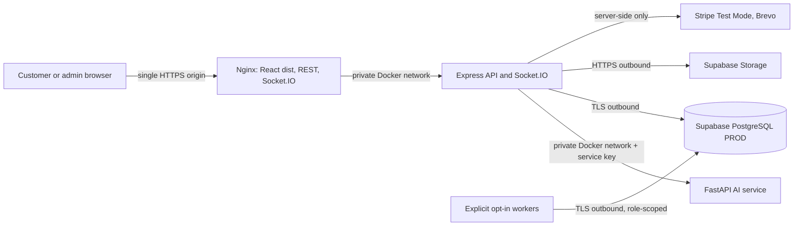

# Task 06.3B — Single-Origin VPS Design

**Review date:** 2026-11-17  
**Repository snapshot:** `feature/06.3-production-infrastructure`, local HEAD `053a271ba36ebcf436720bdc6aa87c7bb79cf149` (the implementation is uncommitted and therefore not represented by that SHA).  
**Architecture score:** 68/100 — **REQUEST CHANGES**.  
**Deployment status:** **NO-GO**. This is a repository design candidate, not a deployment authorization.

| Review area | Score |
|---|---:|
| Same-origin fit with the current browser/API/socket contract | 18/20 |
| Repository release, routing and service-boundary preparation | 23/30 |
| Hostname, Google OAuth and TLS lifecycle proof | 8/15 |
| Capacity evidence for the required full stack | 7/20 |
| Rollback, security operations and provider readiness | 12/15 |
| **Total** | **68/100** |

## Executive recommendation

Use one browser-facing HTTPS origin for the frontend, Express API, OAuth callback, Stripe webhook route and Socket.IO transport. This matches the frontend's relative `/api` and Socket.IO URLs and preserves the existing host-only, `Secure`, `HttpOnly`, `SameSite=Lax` refresh cookies. The candidate edge and service layout is implemented in `infrastructure/production`, but public hostname/OAuth eligibility, browser sessions, Nginx/Compose runtime behavior and host capacity have not been demonstrated.

The current $6/1 GiB Droplet is **not a credible host for the complete checked-out stack as implemented**. The AI loader's estimated cold-load working set alone approaches or exceeds the entire RAM allotment before Python, PyTorch, Node, Nginx, Docker, the OS and request buffers. The local inference model and index are required features; this candidate does not silently remove them. Evaluate a larger host or a separately approved, measured memory-engineering prototype before deployment planning.

No VPS, DNS record, domain, certificate or provider configuration was created. No Supabase system, payment, email or dispatch worker was touched.

## Topology and trust boundaries

| Boundary | Design rule | Evidence / limitation |
|---|---|---|
| Public edge | Only Nginx publishes host ports 80 and 443; container listeners are 8080 and 8443. Unknown cleartext hosts close with 444; unknown TLS SNI is rejected; redirects use the validated configured host. | Static candidate checks added. Nginx itself is unavailable here, so syntax and traffic behavior are NOT VERIFIED. |
| Browser to app | One canonical `https://<lowercase-fqdn>` origin for SPA, `/api/`, `/socket.io/`, Google callback, Stripe webhook and email CTAs. | Origin contract is configurable and fail-closed. Exact hostname not chosen. |
| Express | Authoritative commerce/auth boundary. Only the edge reaches its private backend network. Existing `trust proxy = 1` is safe only while Nginx remains the only reachable HTTP proxy and overwrites forwarded headers. | Source/config inspected; no container runtime test. |
| FastAPI | Not published; reachable only by Express over the AI network with a separate service credential. AI data/index readiness is checked by a private authenticated probe. | Code tests and live index identity remain unverified. |
| Database and media | Existing Supabase PROD PostgreSQL and Storage remain external; no local database or new managed database is introduced. Runtime roles remain separate from migration roles. | PROD identity, privileges, schema and region have not been queried. |
| Workers | Payment, commerce email and AI media workers use opt-in Compose profiles and separate runtime env files. No worker profile is enabled by default or in the deployment command. | Health checks are added. No provider dispatch has run. |

## Nginx route contract

| Incoming path / host | Action | Cache / security behavior |
|---|---|---|
| Canonical host, HTTP `/.well-known/acme-challenge/*` | Serve only the ACME webroot. | Challenge files only; no app fallback. |
| Canonical host, other HTTP paths | Fixed `308` to `https://${CANONICAL_HOST}$request_uri`. | Does not reflect arbitrary `$host`. |
| Unknown HTTP host | `444` close. | No app response or redirect. |
| Unknown TLS SNI | Reject TLS handshake; if a valid TLS SNI is followed by an unknown Host, close with 444. | No wildcard/default application certificate. |
| Canonical HTTPS `/api/health*`, `/api/ready`, `/api/docs*`, `/api/openapi.json` | `404` at edge. | Internal health remains on the private container network. |
| Canonical HTTPS `/api/` | Proxy to Express with method, query, body and raw webhook bytes preserved. | Nginx overwrites Host and `X-Forwarded-*`; request size 10 MiB and bounded connect/send/read times. |
| `/socket.io/` | Proxy Engine.IO polling and WebSocket upgrade to Express. | Buffering off; upgrade/connection headers; 90s read/send timeouts. |
| `/delivery` | No separate proxy route. `/delivery` is the Socket.IO namespace; REST delivery remains under `/api/`. | Socket.IO authentication and role/MFA checks remain in Express. |
| `/assets/<Vite-hashed-file>` | Serve exact file or 404. | One-year immutable cache only on generated hash-shaped asset names. |
| `/assets/*` missing/non-hashed, `*.map` | 404. | No SPA response for missing asset paths; source maps fail closed. |
| `/index.html` | Serve built React entrypoint. | `no-store`/revalidation; no stale origin configuration. |
| Other frontend routes | `try_files` then `/index.html`. | SPA deep links work without matching API paths. |

This table is a configuration contract, not proof of Nginx behavior. Required Docker-backed checks remain outstanding.

## Authentication, cookies, CSRF, CORS and OAuth

- `apps/frontend/src/lib/api.ts` uses relative `/api` calls, includes browser credentials for refresh, keeps customer/admin access-token scopes in memory, and serializes refresh operations. The delivery socket uses a relative namespace URL, `/socket.io` Engine.IO path, access-token auth payload, WebSocket then polling and reconnect/refetch logic.
- Express refresh cookies remain host-only (no `Domain`), `HttpOnly`, `Secure` in production, `SameSite=Lax`, and path-scoped separately to `/api/auth/customer` and `/api/auth/admin`. Rotation, reuse detection, revocation and logout behavior were not relaxed.
- Normal browser traffic is same-origin; the implementation does not broaden CORS or switch cookies to `SameSite=None`. Existing exact-Origin checks for sensitive cookie-authenticated operations remain necessary. SameSite is defense in depth, not a replacement for Origin/CSRF checks.
- **MEDIUM — existing cookie-only refresh/logout CSRF boundary:** `refreshFor` and role-scoped logout handlers consume refresh cookies without an explicit exact-Origin check or CSRF token. SameSite=Lax blocks ordinary cross-site POSTs, but it is not a general same-site sibling-origin control; CORS also does not stop a simple form request from reaching the server. This is existing behavior and was not changed in this topology task. Before public deployment, decide whether to add an exact canonical-Origin guard and verify browser/client compatibility in a separately reviewed auth change.
- Engine.IO CORS does not validate WebSocket `Origin`. The candidate adds `allowRequest` for WebSocket upgrades and exact allowlisted-origin tests while retaining normal polling CORS. These tests do not prove a browser-to-Nginx WebSocket path.
- Google sign-in is implemented, with state, nonce, PKCE S256 and a signed short-lived transaction cookie. `GOOGLE_REDIRECT_URI` is constrained to `${FRONTEND_URL}/api/auth/google/callback`. The OAuth feature is not silently disabled. The actual OAuth provider settings and brand/domain review are unavailable.
- A production cookie/browser matrix on the exact hostname is still mandatory; see [hostname/TLS/OAuth feasibility](TASK_06.3_HOSTNAME_TLS_OAUTH_FEASIBILITY.md) and the [implementation evidence](TASK_06.3_SINGLE_ORIGIN_IMPLEMENTATION_EVIDENCE.md).

## Security headers and privacy

The edge candidate applies HSTS, `X-Content-Type-Options`, `X-Frame-Options`, `Referrer-Policy` and a scoped `Permissions-Policy`; it rejects unknown hosts, hides source maps/diagnostics and logs request URI without query strings or bodies. The static edge does not yet set a Content-Security-Policy. Do not add a speculative policy until script, map tile, image, font, Google OAuth and Stripe origins are enumerated and production-like browser tests prove the policy.

## Payments, email and WebSocket routes

- Stripe remains Test Mode only. `/api/webhooks/stripe` is proxied without body rewrite to the existing raw-body signature verifier. No endpoint was added or changed in Stripe. A valid public HTTPS callback must still be set and verified by an operator before use.
- Brevo is server-side. `COMMERCE_EMAIL_ORIGIN` must be exactly the canonical browser origin for account/order links. No message was sent.
- `/delivery` is not an Nginx upstream path. The Socket.IO client joins the `/delivery` namespace over `/socket.io`; the Express gateway retains the token, customer ownership and admin live-MFA checks. Reconnect and data refetch behavior remain application-owned.

## TLS and hostname lifecycle

The candidate accepts only a configurable lowercase DNS FQDN (not an IP). It includes an ACME-only first-boot HTTP server, a staging-only Certbot bootstrap script, versioned certificate/key installation with root:UID-101 permissions, atomic `current` symlink switch, Nginx `-t` before graceful reload, previous-pointer rollback, a six-hour renewal timer, and a 72-hour local expiry alert. The TLS directory is a read-only host mount and is not included in image layers. See the [TLS lifecycle runbook](TLS_LIFECYCLE.md).

**Not verified:** no DNS hostname/account/record, staging or production certificate, Nginx reload, timer, failure notification or break-glass test exists. The alert service writes to local system logs only; no external on-call/monitoring notification path is configured. The raw-IP certificate path is not selected and is not implemented by these DNS-hostname scripts.

## Exact-SHA release and rollback path

`.github/workflows/deploy-production.yml` is manual-only, restricted to a `develop` workflow SHA, checks exact-SHA quality/security status, builds backend/AI/edge images from locked repository contexts, creates a source archive, records image config IDs and archive hashes, and uploads a seven-day Actions artifact. It does not push to a registry. Deployment waits for the `electrohub-production-deploy` GitHub Environment, then needs host SSH settings and invokes a fixed host deployment entrypoint. The application deploy never runs a database migration.

The host candidate validates the archive and loaded image IDs, production target/origin env shape, reviewed backup-evidence record and local model artifact hashes; validates Compose; moves a release pointer; waits for API, AI-model/index and Nginx health; performs a canonical HTTPS smoke check; restores the prior app release/config on application smoke failure; and retains five release directories/images. Database migrations and database recovery remain separate.

**Release limitations:** workflow not run; GitHub environment reviewers and secrets not verified; no host exists; no immutable registry manifest digest or signed build attestation is produced; base images are version-tagged, not pinned by digest; artifact retention is seven days; first deployment is intentionally blocked by the host script until a prior healthy release exists. A separate approved initial-install/rollback procedure is required.

## Decisions still needed

1. Approve or reject the *repository design* after review; this never authorizes a hostname registration, purchase, VPS, certificate, provider change or deploy.
2. Confirm whether Google OAuth must be available for the release. It is an implemented customer sign-in feature; no one may remove it to fit a hostname.
3. If no domain purchase remains mandatory, decide whether to investigate a DuckDNS or EU.org hostname by separately authorizing account/registration steps. Neither is approved or created here.
4. Replace the $6/1 GiB candidate with a measured-capacity plan or explicitly authorize a safe host experiment after selecting a viable hostname. Current evidence does not support deploying the complete stack on 1 GiB.
5. Obtain Nginx/Docker, all-browser single-origin, external TLS alert/recovery, GitHub Environment, backup/restore and PROD identity evidence before any deployment request.

### References

- [DigitalOcean Droplet pricing](https://www.digitalocean.com/pricing/droplets) — public pricing page reviewed 2026-11-17.
- [Google OAuth web-server flow](https://developers.google.com/identity/protocols/oauth2/web-server?hl=en), [OAuth policy](https://developers.google.com/identity/protocols/oauth2/policies) and [production readiness policy compliance](https://developers.google.com/identity/protocols/oauth2/production-readiness/policy-compliance?hl=en) — reviewed 2026-11-17.
- [Let's Encrypt Certbot IP/short-lived certificate support](https://letsencrypt.org/2026/03/11/shorter-certs-certbot) and [certificate profiles](https://letsencrypt.org/docs/profiles/) — reviewed 2026-11-17.
